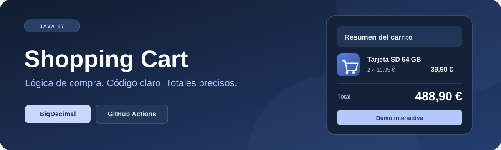

<div align="center">



<br>

**Carrito de compras en Java · POO · Cálculos monetarios exactos**

<br>


### [Ver demo interactiva](https://juanjogamero.github.io/java-shopping-cart/) · [Explorar Java](src/main/java/dev/juanjogamero/carrito) · [Ver tests](src/test/java/dev/juanjogamero/carrito/CarritoTest.java)

</div>

---

## El proyecto

Ejercicio práctico de **Java 17** para gestionar productos en un carrito. Refactorizado con una estructura clara, validaciones y pruebas automatizadas.

<table>
<tr>
<td align="center" width="33%"><strong>01 · Productos</strong><br><sub>Añadir, agrupar y eliminar</sub></td>
<td align="center" width="33%"><strong>02 · Cantidades</strong><br><sub>Modificar unidades y vaciar</sub></td>
<td align="center" width="33%"><strong>03 · Importe exacto</strong><br><sub>BigDecimal, sin errores de coma flotante</sub></td>
</tr>
</table>

## Demo

<a href="https://juanjogamero.github.io/java-shopping-cart/">
  
</a>

La demo web replica las operaciones del carrito con **JavaScript**. El proyecto original se ejecuta en **Java por consola**.

## Código

```java
Carrito carrito = new Carrito();

carrito.agregar(new Elemento(
    "Tarjeta SD 64 GB", new BigDecimal("19.95"), 2
));

System.out.println(carrito.importeTotal()); // 39.90
carrito.actualizarCantidad("Tarjeta SD 64 GB", 3);
```

<details>
<summary><strong>Ejecutar en local (JDK 17+)</strong></summary>

```bash
mkdir -p build/classes
javac -encoding UTF-8 -d build/classes src/main/java/dev/juanjogamero/carrito/*.java
java -cp build/classes dev.juanjogamero.carrito.Main
```

</details>

<details>
<summary><strong>Ejecutar pruebas</strong></summary>

```bash
javac -encoding UTF-8 -d build/classes src/main/java/dev/juanjogamero/carrito/*.java src/test/java/dev/juanjogamero/carrito/*.java
java -ea -cp build/classes dev.juanjogamero.carrito.CarritoTest
```

Las pruebas también se ejecutan con [GitHub Actions](https://github.com/juanjogamero/java-shopping-cart/actions/workflows/pages.yml).

</details>

---

<div align="center">

<sub>Proyecto educativo de programación orientada a objetos · Sin compras ni pagos reales</sub>

</div>
